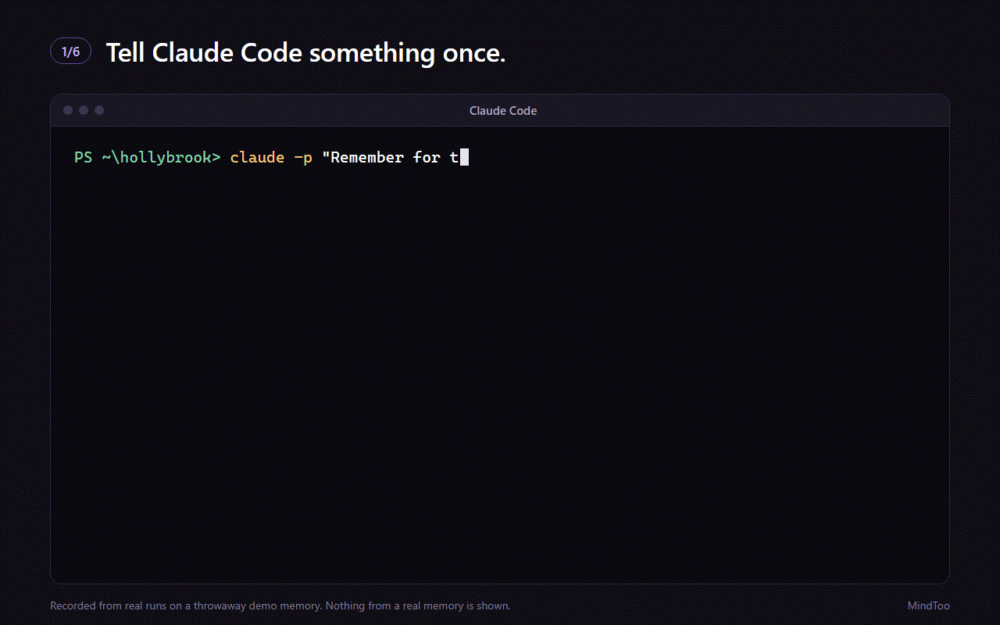

# MindToo

One private memory for your AI assistants.

MindToo keeps what you and your assistants say to each other, on your own computer, and gives each assistant what it needs before it answers.

*Recorded from real runs on a throwaway demo memory. Nothing from a real memory is shown.*

## What it does

- Each message you send and each reply you get is kept as it happens, in Claude Code, Codex, Gemini CLI, Cursor and Windsurf. In the Claude app, MindToo's skill and plugin keep each turn too.
- MindToo finds the assistants on your computer and connects them for you.
- Bring in the conversations Claude Code, Codex and Gemini CLI already hold on your computer, and the data exports of the Claude app and ChatGPT.
- It is all kept in one file in your own Windows user folder. There is no MindToo account and no MindToo cloud.

## Get it

- [Download for Windows](../../releases/latest): Windows 10 or 11, 64-bit. The installer is signed by PrivateAI, Belfast Ltd, so Windows names the publisher. Each release lists the installer's SHA-256.
- Free for 14 days, with everything working. After that, keeping new things needs a licence; reading, search and export stay open.
- £29, including VAT, paid once, at [privateai.ltd/mindtoo](https://privateai.ltd/mindtoo/).
- Founding 100: £19 instead of £29 for the first 100 licences, until 30 November. Enter FOUNDING100 at checkout.

## In this repository

- [Releases](../../releases): the signed installers, newest first.
- [claude-plugin/](claude-plugin/): MindToo's plugin for the Claude app. MindToo hands it to the Claude app for you; it is here so you can read what it does.
- [Issues](../../issues): questions and bugs. Please never paste anything from your own memory into an issue.

MindToo's own source is not in this repository.

## Help

- [Manual](https://privateai.ltd/mindtoo/manual/)
- [Help](https://privateai.ltd/mindtoo/help/)
- [Licence](https://privateai.ltd/mindtoo/licence/)
- Support: support@privateai.ltd

MindToo is made by PrivateAI, Belfast Ltd.

Claude, ChatGPT, Codex, Gemini, Cursor and Windsurf are trademarks of their owners. MindToo is independent and is not affiliated with them.